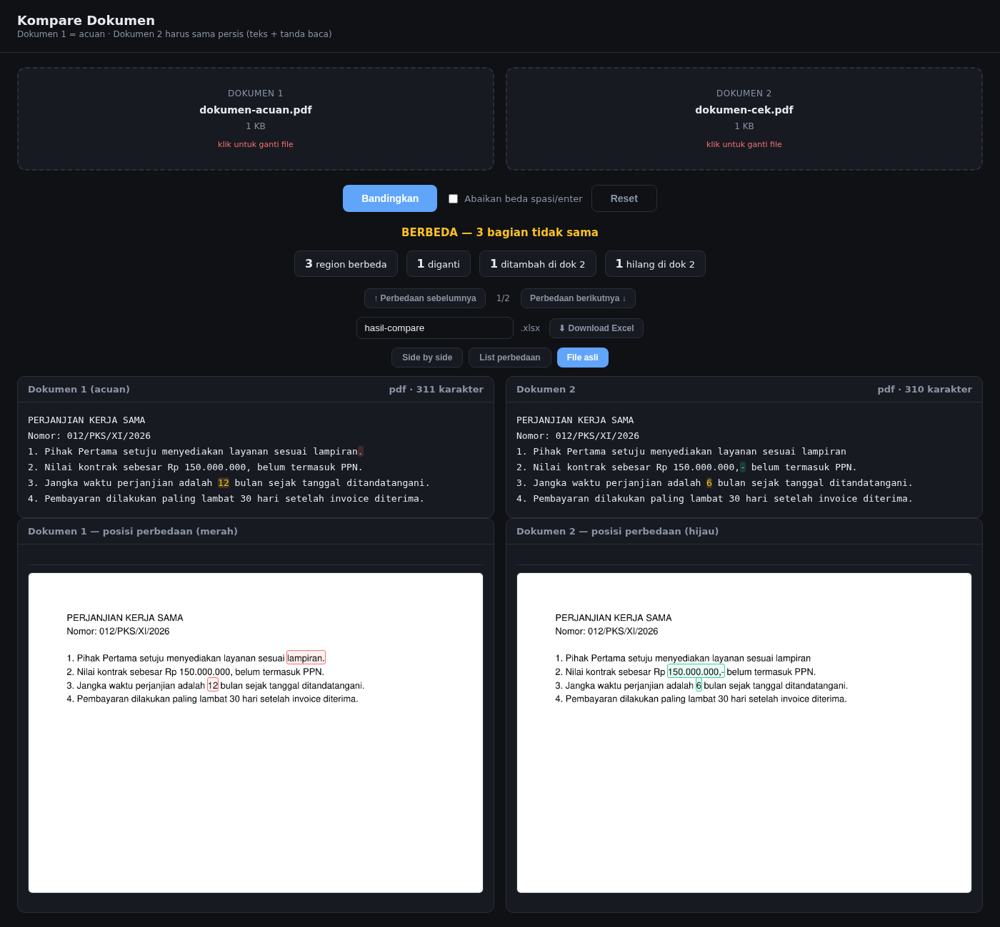
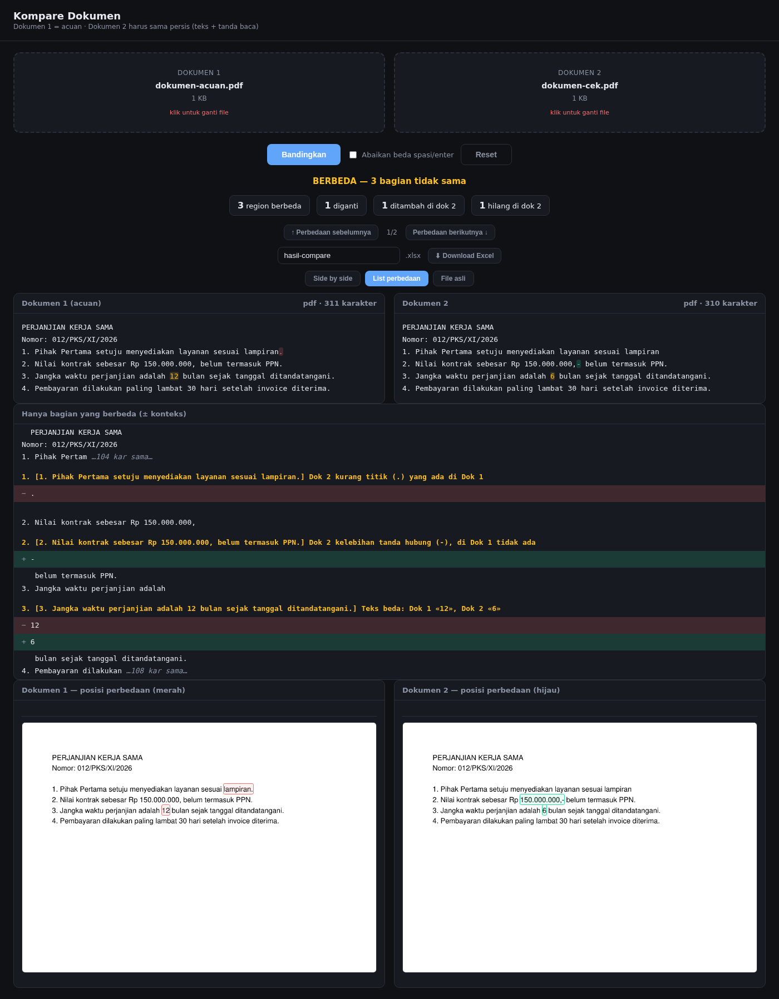

# Kompare Dokumen

> **English summary:** a QA tool that compares two documents strictly. Document 1 is the
> reference, and Document 2 must match it exactly, down to every number and punctuation mark.
> It accepts PDF (including scanned PDFs), Word, images, and plain text, and formats can be
> mixed. Each difference is highlighted on the original file, explained in plain words
> (e.g. "Doc 2 is missing a period"), and can be exported to Excel as a defect list.
> Built with Python, Flask, PyMuPDF, and OCR (Gemini with a local RapidOCR fallback).



Aplikasi QA untuk membandingkan dua dokumen secara ketat. **Dokumen 1 adalah acuan**,
Dokumen 2 harus sama persis (teks, angka, dan tanda baca). Setiap perbedaan ditandai,
dijelaskan, dan bisa di-export ke Excel.

Aplikasi berjalan di laptop sendiri dan dibuka lewat browser di `http://localhost:8000`.

## Fitur

- **Format file:** PDF (termasuk hasil scan), Word `.docx`, gambar (PNG/JPG/WebP/BMP/TIFF),
  dan teks (TXT/MD/CSV/HTML). Boleh campur, misalnya PDF vs gambar atau PDF vs Word.
- **3 cara memasukkan file:** drag & drop, klik untuk pilih file, atau Ctrl+V
  (screenshot atau teks yang di-copy).
- **3 tampilan hasil:**
  - *Side by side*: teks kedua dokumen berdampingan, bagian yang beda diwarnai.
  - *List perbedaan*: daftar bernomor, tiap perbedaan ada poin dan keterangannya
    (contoh: "Dok 2 kelebihan titik (.), di Dok 1 tidak ada").
  - *File asli*: halaman PDF/gambar asli dengan kotak merah (Dok 1) dan hijau (Dok 2)
    di posisi teks yang beda.
- **Abaikan beda spasi/enter:** centang kalau potongan baris kedua dokumen memang beda.
  Kata dan tanda baca tetap dicek ketat.
- **Download Excel:** nama file bisa diubah. Sheet "Defect" berisi satu perbedaan per
  baris (No, Poin, Keterangan, Teks di Dok 1, Teks di Dok 2), sheet "Ringkasan" berisi
  nama file dan jumlah defect.

Contoh tampilan *List perbedaan*:



## Install

### 1. Install Python

Butuh Python 3.10 atau lebih baru: <https://www.python.org/downloads/>

Di Windows, centang **"Add python.exe to PATH"** di layar pertama installer.

Cek di terminal (Windows: buka *Command Prompt*):

```
python --version
```

### 2. Ambil project

Buka <https://github.com/andifajriimaf/doc-compare>, klik **Code → Download ZIP**, lalu
ekstrak. Atau pakai git:

```
git clone https://github.com/andifajriimaf/doc-compare.git
```

Buka terminal di dalam folder project (folder yang berisi `app.py`):

```
cd doc-compare
```

### 3. Install library

Windows:

```
python -m pip install -r requirements.txt
```

Mac/Linux:

```
python3 -m pip install -r requirements.txt
```

Langkah ini butuh internet dan beberapa menit, cukup sekali saja.

### 4. Isi API key Gemini (disarankan)

Gambar dan PDF hasil scan dibaca lewat OCR. Dengan API key Gemini hasil bacaannya jauh
lebih akurat, terutama spasi dan tanda baca kecil seperti titik.

1. Buka <https://aistudio.google.com/apikey>, login akun Google, klik **Create API key**.
   Gratis, tidak perlu langganan.
2. Pasang key di terminal yang sama, sebelum menjalankan aplikasi:

Windows (Command Prompt):

```
set GEMINI_API_KEY=isi_key_kamu
```

Windows (PowerShell):

```
$env:GEMINI_API_KEY="isi_key_kamu"
```

Mac/Linux:

```
export GEMINI_API_KEY=isi_key_kamu
```

Key hanya berlaku di jendela terminal itu, jadi ulangi tiap kali membuka terminal baru.
Jangan simpan key di dalam file project atau membagikannya ke orang lain.

Tanpa key, aplikasi tetap jalan memakai OCR cadangan (RapidOCR) yang kurang akurat.
PDF yang punya teks asli, Word, dan TXT tidak memakai OCR, jadi tidak terpengaruh.

### 5. Jalankan

Windows:

```
python app.py
```

Mac/Linux:

```
python3 app.py
```

Buka <http://localhost:8000> di browser. Untuk menghentikan, tekan Ctrl+C di terminal.

## Cara pakai

1. Masukkan file acuan ke kotak **Dokumen 1** dan file yang dicek ke kotak **Dokumen 2**.
2. Centang "Abaikan beda spasi/enter" kalau perlu.
3. Klik **Bandingkan**. Gambar/scan butuh beberapa detik per halaman.
4. Lihat hasil di tab *Side by side*, *List perbedaan*, atau *File asli*.
5. Ubah nama file kalau perlu, lalu klik **Download Excel**.

## Masalah yang sering muncul

| Gejala | Penyebab dan solusi |
| --- | --- |
| `python` tidak dikenali | Python belum ada di PATH. Install ulang dan centang "Add python.exe to PATH", atau coba `py` sebagai ganti `python`. |
| `No module named ...` | Langkah 3 belum dijalankan, atau dijalankan dengan Python yang berbeda. Ulangi langkah 3. |
| Halaman tidak bisa dibuka | Aplikasi belum jalan atau terminalnya sudah ditutup. Jalankan lagi langkah 5. |
| Port 8000 sudah dipakai | Tutup aplikasi lain yang memakai port 8000, atau ganti angka `port=8000` di baris terakhir `app.py`. |
| Muncul peringatan kuning "OCR akurat (Gemini) sedang gagal" | Server Gemini sedang penuh atau kuota gratis habis. Tunggu sebentar lalu klik Bandingkan lagi. |
| Teks gambar terbaca tanpa spasi | API key belum terpasang di terminal yang menjalankan aplikasi. Ulangi langkah 4 lalu langkah 5. |
| Tampilan tidak berubah setelah update | Browser masih memakai halaman lama. Tekan Ctrl+Shift+R. |

## Catatan

- File yang dibandingkan diproses di laptop sendiri. Kalau API key Gemini terpasang,
  gambar halaman dikirim ke Google untuk dibaca.
- File `.doc` (Word lama) tidak didukung, simpan dulu sebagai `.docx`.
- Kolom "Poin" di Excel dikenali dari baris yang diawali angka, misalnya `1.`, `2)`,
  atau `3.1.`.
